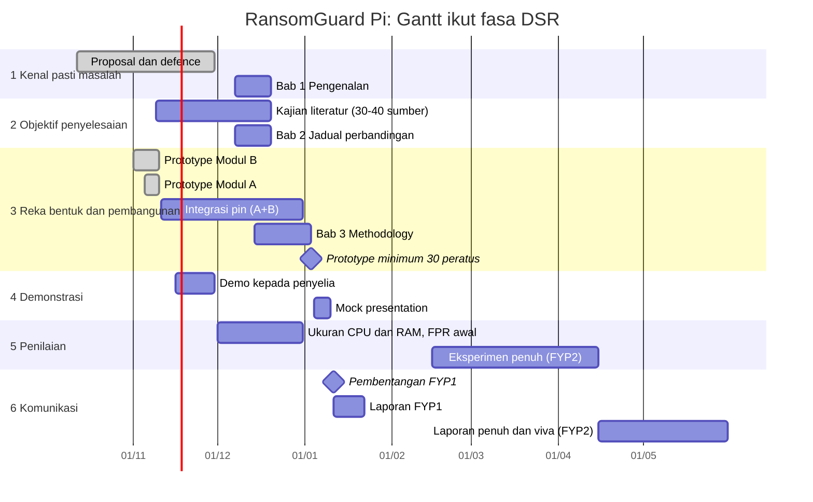

# FYP1 - Draf Methodology dan Gantt

Ringkasan projek: [[FYP1 - Ringkasan Projek dan Garis Masa]] | Kemas kini: 10 Nov 2026

**Status: DRAF** berdasarkan handbook Bachelor of Cybersecurity (Sep 2026). Perubahan yang Dr. Farahwahida minta dalam proposal **belum dimasukkan** kerana belum dicatat. Semak dengan beliau sebelum defence (minggu 6 hingga 7). Sasaran angka di bawah ialah cadangan untuk dipersetujui, bukan keputusan.

## 1. Objektif (boleh diukur)

Handbook: biasanya 3, boleh dipecah jika setiap objektif ada deliverable, reka bentuk dan ujian sendiri. Cadangan 4:

| # | Objektif | Fasa DSR | Bukti (Bab 5) |
|---|---|---|---|
| O1 | Mengkaji pendekatan pengesanan ransomware, backup dan pemulihan, serta mengenal pasti jurang untuk Nextcloud swa-hos pada perkakasan murah | 1 dan 2 | Bab 2: jadual perbandingan 30 hingga 40 sumber, jurang jelas |
| O2 | Membangunkan Modul B: pengesanan awal, pengenalpastian suspek dan pembendungan (sekat IP, alert) pada Raspberry Pi 4 (Haziq) | 3 | Prototype jalan di Pi, ujian fungsi |
| O3 | Membangunkan Modul A: backup berversi, pengesahan integriti dan pemulihan bersih (Faris) | 3 | Prototype jalan di Pi, hasil restore |
| O4 | Menilai sistem bersepadu: kadar pengesanan, masa pengesanan, fail terjejas, positif palsu, kadar pemulihan, penggunaan CPU/RAM | 4 dan 5 | Jadual dan carta, perbandingan dengan baseline |

Sambungan O2 dan O3: `rg-backup pin --before <masa>` dipanggil selepas alert (WP 4.0).

## 2. Research methodology: Design Science Research (DSR)

Sebab: projek **membina artifak** (sistem pengesanan dan pemulihan) dan menilainya. Handbook cadangkan DSR (Peffers; Hevner) untuk kumpulan A Cloud Security dan projek jenis "build a security tool".

| Fasa DSR | Aktiviti dalam projek ini | Output |
|---|---|---|
| 1. Kenal pasti masalah | Klien sync menyebarkan fail terenkripsi ke pelayan; pusat pembelajaran kecil tiada alat murah untuk kesan dan pulih | Bab 1: latar, pernyataan masalah |
| 2. Objektif penyelesaian | Syarat: kesan awal, bendung, pulih, jalan pada Pi 4, kos rendah; jurang daripada 5 kertas dan sumber tambahan | Bab 2: perbandingan dan jurang |
| 3. Reka bentuk dan pembangunan | Senibina Pi + Nextcloud (Docker); Modul B (detector, responder, dashboard); Modul A (restic, manifest SHA-256, pin); model ancaman | Bab 3 dan 4: senibina, aliran, prototype 30% |
| 4. Demonstrasi | Demo serangan simulasi pada Nextcloud sebenar: kesan, sekat IP, Telegram, pin snapshot, pulih | Demo, tangkapan skrin |
| 5. Penilaian | Eksperimen berulang terhadap baseline; metrik dan kriteria berjaya (bahagian 4) | Bab 5 (FYP2) |
| 6. Komunikasi | Laporan FYP1 (Bab 1 hingga 3, 30% Bab 4), pembentangan, kemudian laporan penuh | Laporan, slaid, viva |

Teknik sokongan: **eksperimen terkawal** (fasa 5) dan **threat modelling STRIDE** (fasa 3).

## 3. Development model: Iterative and Incremental (Prototyping)

Handbook: sesuai untuk "detection tools and multi-module systems" dan prototype. Elak Scrum. Bukti ialah sejarah commit Git.

| Iterasi | Hasil | Status |
|---|---|---|
| 1 | Detector asas (canary, kadar perubahan, entropi), simulator, ujian automatik | Siap |
| 2 | Pengendalian `.part` Nextcloud dan rename klien sync; ujian pada Nextcloud sebenar | Siap |
| 3 | Dashboard (pengguna, IP), responder (sekat IP, Telegram), auto-unblock | Siap |
| 4 | Modul A: backup berjadual, restore dan pengesahan hash, pin | Siap (Faris) |
| 5 | Sambungan `--snapshot-cmd` ke `rg-backup pin`; ujian hujung ke hujung | Belum |
| 6 | Lumpuhkan akaun dan batal sesi; systemd; pengerasan | Belum |
| 7 | Penilaian penuh dan pengerasan | FYP2 |

## 4. Rancangan penilaian

**Persekitaran ujian:** satu Raspberry Pi 4 (8GB RAM, microSD 64GB, repo backup atas SSD USB), Nextcloud + MariaDB dalam Docker, 2 hingga 3 klien sync pada rangkaian makmal. Simulator selamat (fail penanda `.ransomguard_testbed`), tiada ransomware sebenar.

**Baseline:**
1. Nextcloud tanpa perlindungan (hanya trash dan versi lalai): fail yang hilang dan masa pulih.
2. Angka kajian terbitan sebagai rujukan, bukan perbandingan langsung (dataset berbeza): Ranker (recall 98.98%, FPR 0.11%), Deceive-Detect-Defend (98.4%), Amoruso (100% penuh, kira-kira 90% separa).

**Metrik dan sasaran cadangan (untuk dipersetujui dengan penyelia):**

| Metrik | Takrif | Sasaran cadangan | Keputusan semasa |
|---|---|---|---|
| Kadar pengesanan | serangan dikesan / jumlah serangan | 95% atau lebih | 8/8 (sampel kecil) |
| Fail terjejas sebelum alert | fail rosak sebelum alert | 10 atau kurang | dalam had untuk 8/8 |
| Masa pengesanan | mula serangan hingga alert (s) | beberapa saat | diukur dalam `results.json` |
| Kadar positif palsu | senario normal yang mencetus alert / jumlah | serendah mungkin, laporkan bersama selang | 0/5 (sampel kecil) |
| Masa pembendungan | alert hingga IP disekat (s) | belum ditetap | belum diukur |
| Kelewatan notifikasi | alert hingga Telegram diterima (s) | belum ditetap | belum diukur |
| Beban sistem | CPU dan RAM Pi, semasa rehat dan serangan | belum ditetap | **belum diukur** |
| Kadar pemulihan (Modul A) | fail dipulihkan dengan hash sepadan / fail terjejas | 100% | 287/287 (ujian dd, bukan simulator) |

**Perlu ditambah:** sampel lebih besar (cadangan sekurang-kurangnya 30 larian serangan dan 30 larian normal setiap jenis, termasuk muat naik pukal, video, zip), serangan perlahan dan separa, dan ujian hujung ke hujung dengan simulator melalui klien sync. Jangan laporkan ketepatan sahaja, laporkan juga recall, FPR dan masa.

## 5. Model ancaman dan skop

| Aspek | Penetapan |
|---|---|
| Penyerang | Mengawal satu komputer pengguna yang ada akses sync Nextcloud |
| Andaian | Pi dan akaun admin tidak dikompromi |
| Dalam skop | Enkripsi fail melalui klien sync, pengesanan, pembendungan, backup dan pemulihan |
| Luar skop | Pecah masuk Pi, pencurian data (double extortion), ransomware sebenar pada rangkaian produksi, hardening gred perusahaan |
| Rangka kerja | STRIDE untuk model ancaman; MITRE ATT&CK T1486 (Data Encrypted for Impact) untuk corak serangan; NIST CSF (Detect, Respond, Recover) untuk pemetaan fungsi |

## 6. Deklarasi etika dan undang-undang (templat handbook)

Semua ujian penyelidikan ini dijalankan di makmal sendiri menggunakan Raspberry Pi, akaun ujian dan simulator selamat. Tiada ujian dijalankan pada sistem hidup atau pihak ketiga tanpa kebenaran bertulis. Tiada data peribadi sebenar digunakan, dan tiada sampel ransomware sebenar dikendalikan.

## 7. Gantt (baris ikut fasa methodology, bukan bab)

Tarikh FYP1 daripada garis masa Oktober 2026. Minggu FYP2 ialah anggaran, sesuaikan dengan kalendar fakulti.

| Minggu | Tarikh | Fasa DSR | Penanda |
|---|---|---|---|
| 5 | 9 hingga 15 Nov | 1, 2, 3 | Kemas kini topik, Gantt |
| 6 hingga 7 | 16 hingga 30 Nov | 1, 4 | Proposal defence dan demo prototype |
| 8 | 7 hingga 13 Dis | 1, 2 | Bab 1 dan 2 |
| 9 | 14 hingga 20 Dis | 2, 3 | Hantar Bab 1 dan 2; mula Bab 3 |
| 10 hingga 11 | 21 Dis hingga 3 Jan | 3, 5 | Hantar Bab 3; prototype minimum 30% |
| 12 | 4 hingga 10 Jan | 4, 6 | Mock presentation |
| 13 | 11 hingga 17 Jan | 6 | Pembentangan akhir (35%) |
| 14 | 18 hingga 22 Jan | 6 | Laporan FYP1 (35%) |

## 8. Semakan dengan senarai semak Bab 3 handbook

- [x] Research methodology dinamakan (DSR), development model dinamakan (Iterative and Incremental)
- [x] Fasa diterangkan dengan aktiviti projek sendiri; setiap objektif ada fasa
- [x] Baseline, persekitaran ujian dan metrik ditakrif
- [x] Model ancaman dan andaian penyerang; piawaian dirujuk (STRIDE, MITRE ATT&CK, NIST CSF)
- [x] Deklarasi etika
- [x] Gantt ikut fasa methodology
- [ ] Jurang Bab 2 sepadan dengan Bab 3 (perlu 30 hingga 40 sumber, kini 5)
- [ ] Rajah senibina dan carta alir sepadan dengan repo Git
- [ ] Sasaran metrik dipersetujui dengan penyelia
- [ ] Perubahan daripada Dr. Farahwahida dimasukkan

## 9. Untuk dibincangkan dengan Dr. Farahwahida

- Apakah perubahan yang beliau minta dalam proposal? (isi di sini)
- Adakah DSR dengan Iterative and Incremental diterima?
- Adakah sasaran metrik dan saiz sampel memadai?
- Adakah bidang ini (ransomware, cloud security) sesuai dibimbing beliau, memandangkan senarai penyelia memaparkan tajuk computer vision?
